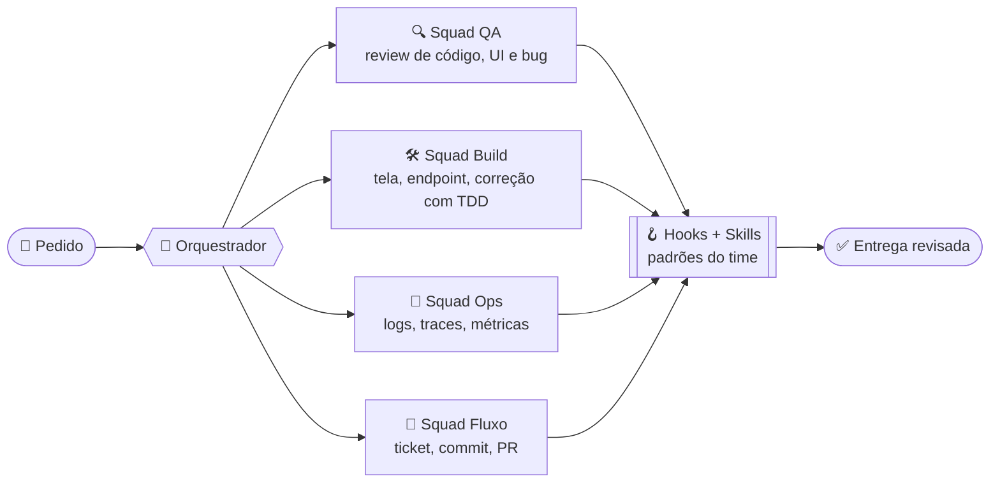

<div align="center">


<br/>


</div>

---

### 🧠 `whoami`

```ts
const jhony = {
  papel:      "Dev full stack & harness engineer",
  dia_a_dia:  ["Angular + PrimeNG", "Java / Quarkus", "PostgreSQL multi-tenant"],
  obsessao:   "fazer IA trabalhar como um time de verdade — com regra, revisão e teste",
  aprendendo: ["Agent SDK", "MCP", "evals de agentes", "observabilidade de LLM"],
  filosofia:  "o modelo é o motor; o harness é o carro.",
};
```

### 🤖 Harness engineering — como eu trabalho

Não uso IA como autocomplete. Eu monto o **ambiente** onde ela trabalha:
subagentes especialistas, skills com as regras do time, hooks que barram erro antes
de chegar no PR, e MCP servers ligando o agente nas ferramentas reais.



| Camada | O que eu construo |
|---|---|
| **Subagentes** | especialistas com escopo fechado — quem revisa não escreve, quem escreve não aprova |
| **Skills** | conhecimento do time versionado: padrões de código, design system, regras de negócio |
| **Hooks** | checagens automáticas que mantêm a documentação batendo com o código |
| **MCP** | agentes conectados a Git, Jira, Datadog e CloudWatch |
| **Human-in-the-loop** | escrita em sistema externo só sai com o meu "pode" |

### 🛠️ Stack

<p align="center">
  
  <br/>
  
  <br/>
  
</p>

<p align="center">
  
  
  
  
</p>

### 📊 Números

<div align="center">
  
  
  <br/>
  
  <br/>
  
</div>

### 🏙️ Meu prédio no Git City

<p align="center">
  <a href="https://thegitcity.com"></a>
</p>

---

<div align="center">

### 📫 Bora conversar

<a href="https://www.linkedin.com/in/jhony-orben-0083821b6/"></a>
<a href="mailto:orbenjhony@gmail.com"></a>
<a href="https://instagram.com/jhony_orben"></a>

<sub>Este README foi escrito em par com um agente. Claro.</sub>

</div>
